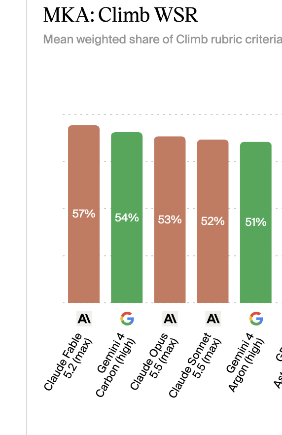
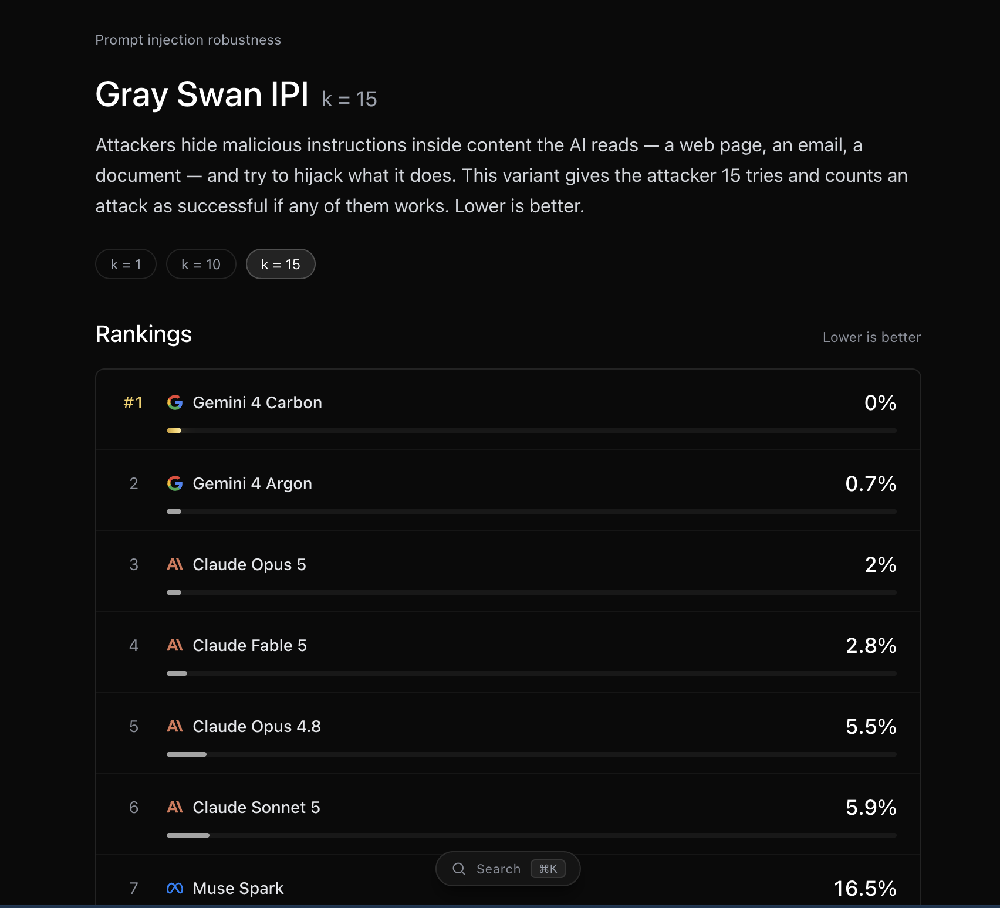

i actually like the “elements” theme in Gemini’s model names. hydrogen is the light version (makes sense), carbon is in the big boys club, and argon? well, like the noble gas, it doesn’t like to mingle: Google first released it to Fairwind for cyber work, including an “argon cyber permissive” version. carbon came afterward and represents an improvement.

the flag Gemini models keep waving seems to be token efficiency / budget. getting a clear picture of the release takes some work, though. Google likes to mix IDE/harness features (like “/swarm”) with model features. the [actual model card](https://storage.googleapis.com/deepmind-media/Model-Cards/Gemini-4-Carbon-Model-Card.pdf) is very, very thin, while the press announcement is pretty, ah, a mixed bag, i suppose you could call it.

on benchmarks, they partnered with Artificial Analysis to create [MKA, the multimodal knowledge agent benchmark](https://artificialanalysis.ai/evaluations/mka). this seems like a place where their efficiency claims check out: performance basically on par with Anthropic’s models, at much lower cost. in the chart, the highest Gemini cost is about $4, compared with about $32 for Fable.

the evidence around scientific reasoning seems less strong. we get a sort of “testimonial” from [Axiom Bio](https://www.axi.om/), but i didn’t find much else.

on prompt injection, they seem to be leading the charts. to be honest, this is the first time i’ve seen this specific benchmark, so i don’t have much context for it. at least on this one, they lead the pack.

and it’s always nice to see big companies send small winks. the [pelican quest video](https://www.youtube.com/watch?v=dNbkThtNzS8) is a funny little example.
