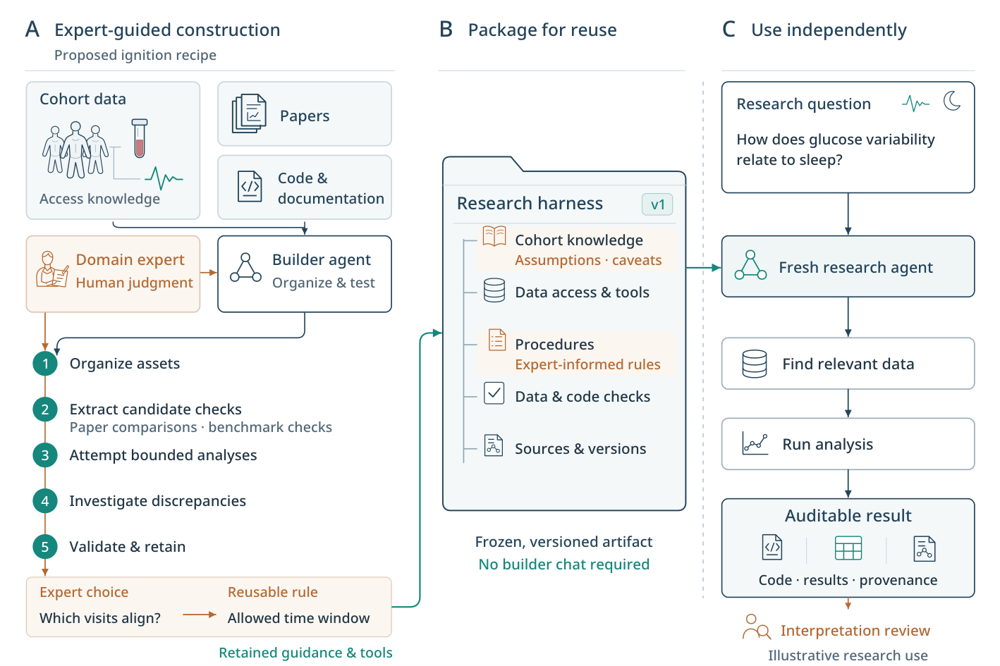

domain-specific harnesses seem to be getting a lot of attention lately, deservedly, i think. with models improving at the current rate, the environment we give them is one of the more useful things we can optimize.

i've been working on this for the Human Phenotype Project, a biomedical cohort. by harness i mean the tools and context an agent has available when doing research with us. we have years of work around this data already: i want the agent to quickly make use of what we've learned without us having to explain it all again at the start of each session.

the harness needs to capture the know-how, the “special sauce” of the people who understand the domain. some of that is in papers and working code. some of it is still in their heads. a researcher reviewing an analysis might immediately see why it is wrong (even though nothing in the documentation would have helped the agent avoid the mistake). how do we encode that kind of knowledge? asking the researcher to write down everything they know seems unlikely to get us very far.

working through an existing paper seems like a useful starting point. we can attempt its analysis with the cohort data, then investigate the differences with someone who understands the study. a discrepancy might reveal an assumption missing from the methods, or simply a difference in the data available now (vs what was available for the original study). it might also concern eligibility criteria: the researcher may know, for example, that the analysis should exclude participants who reported taking a particular drug or having a particular disease. recording the explanation would give the next agent something it didn't have before (how much expertise we can capture this way and whether it's enough are still open questions).

papers are only one source of feedback. prediction tasks give us measured answers to check against, and experts can judge choices that don't have a simple numerical score. building the harness means making useful tools and context out of these different signals, while preserving ways to check whether they help.

for example, suppose we want to know how glucose varies across sleep stages. joining the recordings by participant doesn't establish that they cover the same nights. someone familiar with how the cohort was collected can help determine which recordings can be used together. once that choice is made, code can find the overlap and report which recordings were excluded. the reason for choosing that window should be documented too, so someone asking a different question can reconsider it.

anything that can be deterministic code should be code. trivial, but there is little reason to have the agent reconstruct that operation from instructions in a skill every time. subsequent analyses can call the tested implementation.

the domain-specific part also needs to actually be specific. if i find myself telling the model to “think carefully” rather than supplying knowledge about our data, i think i'm probably doing something wrong. OpenAI's [guidance for reasoning models](https://developers.openai.com/api/docs/guides/reasoning-best-practices#how-to-prompt-reasoning-models-effectively) explicitly says that asking them to “think step by step” is unnecessary. its [GPT-5.5 guidance](https://developers.openai.com/api/docs/guides/latest-model?model=gpt-5.5) similarly recommends reducing prescribed steps unless the exact process matters.[^1] i want to piggyback on that progress. the model still needs to know how *our* recordings were collected and what we've learned about using them. instructions compensating for a model's general limitations should be reconsidered when the model changes.

so, as lean as possible (but not leaner). start with the pieces we have, and check whether they help on actual research tasks. try removing instructions too, while checking that the agent still uses the data correctly. both the process of building the harness and the research done with it should benefit from better models, which is another reason to keep the structure simple and the models replaceable.

this is the shape we're working toward:

*Figure 1. constructing the harness and using it are separate processes. a fresh agent should be able to use what we've assembled without the builder's conversation.*

the question in the figure is one possible starting point. research can also begin with a paper or a dataset we haven't understood yet (or one we understand very well but want to explore in a new direction). useful lessons could go back into the harness after expert review. this might be as small as a change to a data loader that makes the measurement units explicit in what it returns. once checked and retained, that change helps the next analysis too. an incorrect lesson could mislead subsequent analyses, so deciding what to retain is part of the work.

preparing the working environment is familiar territory in other fields. Bourdain wrote about mise en place in *Kitchen Confidential*:

> “As a cook, your station, and its condition, its state of readiness, is an extension of your nervous system.”

[Anthony Bourdain, *Kitchen Confidential*](https://www.goodreads.com/quotes/9425801-as-a-cook-your-station-and-its-condition-its-state)

if agents are going to be extensions of our nervous systems, it seems worth preparing their working environment with the same care. and for research, there is Pasteur:

> “In the fields of observation, chance favors only the prepared mind.”

[Louis Pasteur, 1854](https://www.nasa.gov/universe/multimessenger-links-to-nasas-fermi-mission-show-how-luck-favors-the-prepared/)

i think building these harnesses is worth the effort, provided we're clear about what we're trying to achieve: make the experts' knowledge usable and lower the startup cost of research. the next step is to check whether a fresh agent can get to useful work sooner, without repeating mistakes we've already worked through.

research worth doing is worth doing well. i want the harness to help us understand the questions we're working on, including when the evidence takes us somewhere we didn't expect. that means making what we've learned available without treating it as settled. the aspiration is to help both the agent and the researcher do better science.

*thanks to Hagai Rossman for insightful discussions that helped shape these ideas.*

[^1]: see also [this post on Opus 5.5](https://x.com/dbreunig/status/2102449351322947900). Anthropic's [prompting guide](https://platform.claude.com/docs/en/build-with-claude/prompt-engineering/prompting-claude-opus-5-5#thinking-instructions-in-chat-system-prompts) suggests removing instructions to think carefully before answering in chat applications using Opus 5.5.
