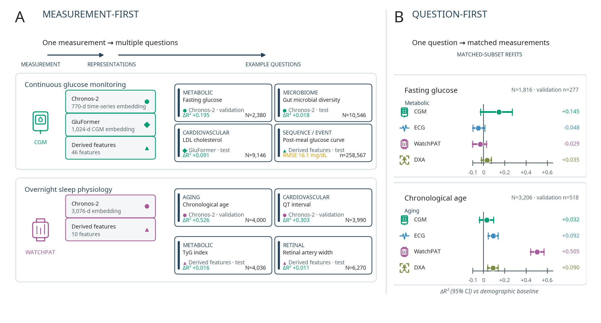
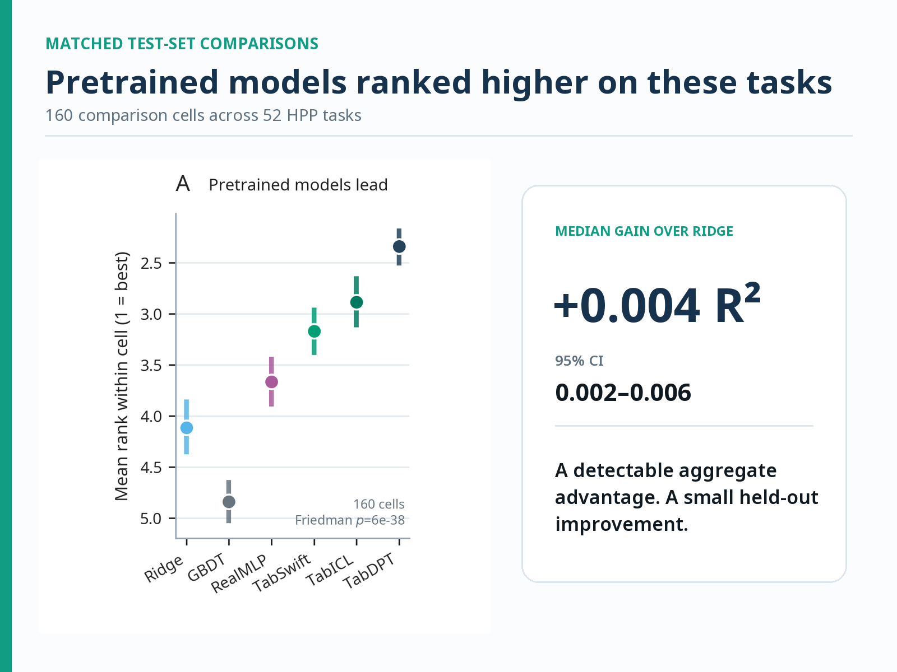
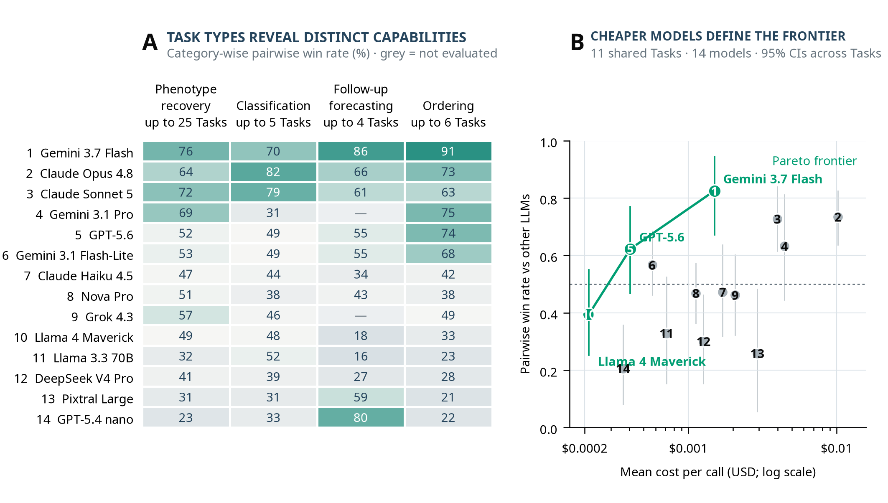

*this post accompanies the PhenoBench preprint (link once arXiv finishes moderation). also see the [public repo](https://github.com/galsapir/phenobench-benchmark) and [website and leaderboards](https://galsapir.github.io/phenobench-benchmark/).*

a while back i wrote about [data activation](https://sparsethought.com/2026/01/17/data_activation/): how we can use the data we collect and organize with great care to inform and improve AI systems. we have increasingly powerful models, and a lot of hard-won data that they still struggle to make much use of. finding useful ways to connect the two seems like an important thing to work on, especially in medicine.

i then wrote about how [building benchmarks is one way to do this](https://sparsethought.com/2026/07/03/benchmarking-as-data-activation/). being able to measure what a model can do with your data already gives you something. eventually, some of those tasks might also become environments where models can learn, with a score that gives them a meaningful hill to climb.

to act on what i was preaching, and because i honestly think this is immensely valuable, i spent the last couple of months at work building such a system with my colleagues, using the data we had access to. the result is PhenoBench. i wanted to describe it a bit, what we discovered in the process, and where i think it could go.

PhenoBench is built around the [Human Phenotype Project](https://doi.org/10.1038/s41591-025-03790-9), a longitudinal cohort in which more than 13,000 participants have completed their initial visit. the same people have clinical measurements, imaging, molecular profiling, and wearable recordings, with follow-up over years. that combination gives us quite a lot to ask.

we wanted to answer questions about the data, and use the data to answer questions about models. the first part has two directions: given a health question, which measurements help answer it? and given a measurement, what else can we learn from it?

before we could explore either, we had to decide what a question actually consisted of.

one thing we were fortunate enough to have was a substantial body of scientific work using the cohort. papers are amazing assets for this kind of work. someone has already spent time deciding which question matters, how to measure the thing, and what a result might mean.

[PaperBench](https://arxiv.org/abs/2504.01848) and the [work from the folks at LatchBio](https://arxiv.org/abs/2605.28065) are interesting examples of using scientific papers to build evaluations. replicating research, or recovering a biological result from its underlying data, is a substantial task in itself. we took a somewhat different direction: extracting questions from studies, curating the ones we thought were useful, and building reusable tasks with explicit baselines. we also added questions from clinical knowledge and from the work of building the benchmark itself.

take HbA1c as a simple example. we have a measured laboratory value, and we can ask how well different information sources help estimate it. a shortened version of its [task card](https://github.com/galsapir/phenobench-benchmark/blob/main/task-cards/hba1c.md) looks something like this:

- **question:** estimate a participant’s HbA1c measured at the same study visit.
- **population:** participants with a valid target measurement who meet the task’s eligibility criteria.
- **answer:** a number, in percent.
- **evaluation:** compare predictions with the measured values in participants reserved for evaluation.
- **baseline:** how much can age, sex, and BMI already tell us?

we can then add information: glucose-monitoring summaries, blood metabolites, or another measurement. each permitted information set defines a comparison setting, which we call a benchmark track. within it, models get the same inputs and are evaluated under the same conditions.

some of these choices sound like details until you get one wrong. predicting a measurement at the same visit is a different question from predicting it two years later. a model that looks impressive may mostly be recovering information already available from age or BMI. the task card is where we explain these choices and their clinical meaning; the executable task makes them part of the evaluation.

we ended up with 90 tasks across 15 clinical domains. they include estimating measurements, classifying health-related states, forecasting follow-up values, predicting sequences, and ordering participants.

once those questions were defined, we could start looking across them.

*the left side follows a measurement into several questions. the right side holds each question and its evaluation conditions fixed while changing the information source.*

the right side is probably the easiest place to start. for fasting glucose, CGM gave the largest improvement over the demographic baseline among the measurements compared. for chronological age, sleep recordings did. within each question, these comparisons use the same participants and the same prediction method.

the left side goes in the other direction: take a measurement, such as continuous glucose monitoring, and examine the different questions it might inform. those examples use different cohorts and outcomes, so their numbers need to be read separately. together, they give us a way to explore what the cohort contains without assuming that one measurement will be useful everywhere.

a lot of groundwork went into enabling this. the majority of the time and “human tokens” probably went into distilling the scientific process and clinical knowledge into the tasks and their comparisons. but once we had that, we could also ask how well different models used the available information.

we focused on two examples.

the first was tabular foundation models. these are pretrained models for data organized in tables, and they are worth paying attention to. [Christoph Molnar explains the idea much better than i can](https://mindfulmodeler.substack.com/p/tabular-ml-is-about-to-get-weird). in approaches such as [TabICL](https://arxiv.org/abs/2502.05564), you give the model labeled examples as context, and it predicts new rows without updating its pretrained weights. part of the appeal is getting strong predictions on relatively small datasets with little task-specific tuning.

that makes biomedical prediction an interesting place to try them. we have many questions, often with modest amounts of usable data for each one. a [recent Nature Methods perspective](https://www.nature.com/articles/s41592-026-03182-y) asks a related, broader question: what should count as a meaningful evaluation of a biomedical foundation model?

we compared TabSwift, TabICL, and TabDPT with ridge regression, gradient-boosted trees, and RealMLP across 160 matched comparisons spanning 52 tasks.

they did fare better overall. but the median improvement over ridge was only 0.004 R², averaging the three pretrained models within each comparison.

i think that is an interesting result. these models have a measurable advantage on these HPP tasks, and the size of that advantage matters when deciding what to use. having many comparable tasks lets us examine both, rather than picking a single example where a model happens to do well.

the second thing we tried was giving some of the questions to LLMs.

here the setup is quite simple to describe. hide a measured phenotype, give the model a packet of other measurements from that participant, and ask it to estimate the missing value. then compare the answer with what was actually measured, and with a conventional model fitted using the same fields.

the packet contained demographics, CGM summary metrics, and blood metabolomics. the LLMs received no worked input–answer examples and no cohort-specific fine-tuning. some runs also included explanatory task-card context. the [prompts, schemas, and a synthetic example](https://github.com/galsapir/phenobench-benchmark/tree/main/pb-llm) are public; participant data remain access-controlled.

we evaluated 14 models across 40 tasks, with different models covering different subsets. these included estimating hidden measurements, classification, follow-up forecasting, and ranking small groups of participants.

*the heatmap compares LLMs with one another within task categories. the cost plot uses the eleven tasks evaluated by every model. neither plot measures performance relative to the fitted baselines.*

the fitted models were generally stronger. on the tasks involving recovery of a hidden continuous measurement, LLMs beat the ridge model using the same fields in only 9 of 304 model–task comparisons.

the LLMs also differed quite a lot in where they did relatively well. GPT-5.4 nano, for example, was much more competitive in follow-up forecasting than in phenotype recovery or classification. spending more per call did not guarantee better performance either.

some failures were more revealing than the rankings. for retinal artery width, every model gave answers on a micrometre-like scale while the actual target was recorded in image-analysis pixels. a model can recognize the medical concept and still get the particular measurement badly wrong.

the short explanations were interesting too. in the visceral-fat ranking tasks, some models referred to sex, BMI, and lipid measurements in ways that sounded plausible. but a plausible explanation only gets us so far. we can check the ordering against the measured values, and the fitted comparator generally remained stronger.

this feels like a useful example of the jagged frontier: ability varies considerably with the question, even within this fairly constrained set of health tasks.

it also connects to something i keep wondering about more broadly. where we have good tasks, abundant data, and clear ways to score improvement, we can put substantial effort into making models better. in health, a lot of the work still goes into deciding what “better” should mean and arranging the data so we can measure it. i suspect that explains some of the uneven progress. these experiments don’t establish that explanation, but they give us concrete cases to investigate.

there were side quests too. one was testing whether agents could use PhenoBench to answer research questions about its results and comparison rules. that is in the appendix, for anyone interested.

the part i keep coming back to is how much work preceded the model calls. deciding what to ask, which information belongs in the question, and what would count as a useful answer took most of the effort. once those decisions were made explicit, we could try another model or another representation without starting the whole process again.

that is the form of data activation we have managed so far. the data gives us a way to examine model capability, compare methods, and identify specific things worth improving. next come more tasks, additional measurements, and testing whether better ways of presenting the evidence help. training against some of these tasks is another direction i’d like to explore, with separate tasks kept for evaluation.

for now, the [task cards, results, and contribution instructions are available here](https://github.com/galsapir/phenobench-benchmark). if you have a model you’d like evaluated, there is a manual submission path. if you think a question should be defined differently, or that we are missing a useful one, i would be interested in that too.
