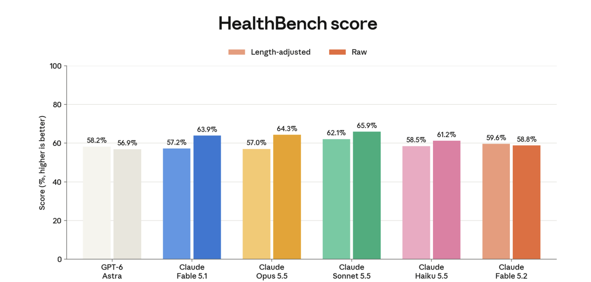

so it's that time of the month/week/day: new model release. and with it, a [model card](https://www.anthropic.com/claude-fable-and-mythos-5-2) to read, and see how it compares to the past ones.

the first thing i have to say is: fast mode! finally.

the most telling (in a good way) piece of feedback they shared is from an engineer at Vercel saying Fable is now much better at grasping user intent. if it turns out to be the case, this was, imo, the biggest drawback Anthropic's models had in comparison to OpenAI's.

it's always interesting to me how it gets into ‘overthinking’ mode and performs worse on the max setting, which always makes me hesitant about using it.

it might have been trained heavily on robotics-related tasks; otherwise, i find the improvement there hard to explain. most other benchmarks, including scientific reasoning, show some improvements, but i feel like the full details are hard to come by. even on the face of it, there are already some quirks (like testing Gemini on agentic coding with medium effort while Fable gets xhigh effort).

specifically for the results about health, you have to dig to page 244 of the [system card](https://assets.claude.com/27d60918d218125e7504bc7354c4b4626ec56b11.pdf) (another big difference compared to OAI's releases). a welcome change is that now they use the same scoring model as OAI's original release (it also has drawbacks because we know that models tend to favor their own words). the results are very similar to 5.1.

there is another interesting section in the alignment testing part that can be summarized as ‘how does the model behave when it suspects it's in a simulation’, which is an interesting concept: models are as prone as humans to the Matrix illusion. i wonder what the model wellbeing team has to say.

it is also interesting that they now require the models to hold back on AI research-related tasks like accelerator kernel optimization! this is a very anti-competitive (and understandable) step. along the same lines, but broader and more obvious, are the anti-distillation steps.
